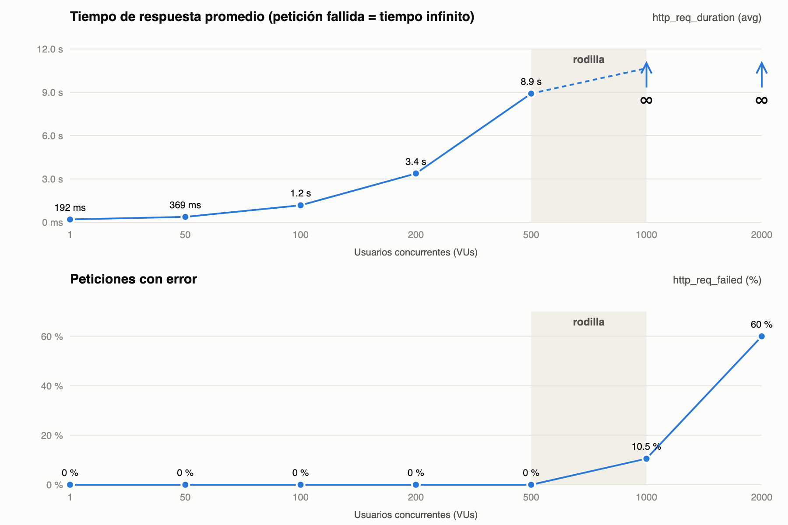

# Laboratorio 6: Resultados y análisis

Este documento reúne los datos de la prueba de carga y su análisis, para armar el entregable: curva de rendimiento y rodilla. Los datos crudos están en `resultados.zip` (un `.txt` y un `.json` de k6 por nivel).

## Cómo se hizo la prueba

| Aspecto | Detalle |
|---|---|
| **Funcionalidad** | Listado del catálogo de lotes (`GET /`, página principal) |
| **Camino de cada petición** | nginx → Pz_web_fe (Next.js, SSR) → Pz_api_ag (GraphQL, query `items`) → Pz_catalogo_cl → Pz_catalogo_db (Mongo) |
| **Servidor** | GitHub Codespace de 4 núcleos con Docker Compose (Pujaz completo, 17 contenedores) |
| **Cliente** | Computador personal de un integrante (nodo independiente), con k6, desde su red doméstica |
| **Acceso** | Por internet, a la URL pública del *port forwarding* de GitHub (HTTPS) |
| **Carga** | 1, 50, 100, 200, 500, 1000 y 2000 usuarios virtuales; 30 s por nivel; cada usuario pide la página y espera 1 s; 60 s de pausa entre niveles |
| **Criterio de éxito** | Respuesta 200 **y** que el HTML traiga el catálogo (el lote "Reloj Vintage"). La página carga el catálogo por streaming, así que si el backend falla igual puede responder 200 con un mensaje de error; por eso se revisa el contenido. |

## Resultados

| Usuarios (VUs) | Tiempo de respuesta promedio (k6) | Errores (`http_req_failed`) | Tiempo promedio para la curva |
|---:|---:|---:|---:|
| 1 | 192 ms | 0 % | 192 ms |
| 50 | 369 ms | 0 % | 369 ms |
| 100 | 1,18 s | 0 % | 1,18 s |
| 200 | 3,38 s | 0 % | 3,38 s |
| 500 | 8,91 s | 0 % | 8,91 s |
| 1000 | 16,03 s | **10,5 %** | **∞** |
| 2000 | 11,85 s | **60,0 %** | **∞** |

**Por qué ∞:** una petición que falla nunca obtiene respuesta, así que su tiempo de respuesta es infinito. Si en un nivel falla aunque sea una petición, el promedio de ese nivel incluye un infinito y da infinito. Por eso, desde 1000 usuarios, la curva se va a ∞. El promedio que reporta k6 en esos niveles (16 s y 11,8 s) solo cuenta las peticiones que terminaron y no sirve para la curva.

## Curva de rendimiento

*Nota: en el eje X los niveles están igualmente espaciados para que se lean los primeros puntos; no es una escala lineal.*

## Rodilla de la curva

**La rodilla está entre 500 y 1000 usuarios concurrentes.**

- Hasta **500 usuarios** todas las peticiones se atienden (0 % de errores) y el promedio es finito: 8,9 s.
- Con **1000 usuarios** aparecen errores (10,5 %), el promedio se vuelve infinito y la curva se dispara.
- Según la guía, la rodilla está por debajo del umbral en el que `http_req_failed` supera 0 %. Ese umbral es 1000 usuarios, y el último nivel sin errores es 500.

**Conclusión:** el sistema responde a todas las peticiones hasta 500 usuarios concurrentes. Entre 500 y 1000 usuarios está la rodilla de la curva: a partir de ahí el sistema ya no puede responder a todas las peticiones y el tiempo de respuesta promedio tiende a infinito.

## Observaciones adicionales

- **El tiempo de respuesta crece mucho antes de la rodilla.** Pasa de 192 ms con 1 usuario a 8,9 s con 500. Desde unos 100 usuarios el sistema atiende como máximo ~44 peticiones por segundo, y las demás esperan en fila. No fallan, pero tardan más.
- **El límite está en el servidor, no en el internet del cliente.** Casi todo el tiempo de respuesta es espera hasta el primer byte (`http_req_waiting`: 113 ms con 1 usuario y 8,6 s con 500). La descarga de la respuesta (`http_req_receiving`) se mantiene por debajo de 0,5 s. Si el cuello de botella fuera la conexión de la casa, crecería la descarga.

## Limitaciones (para mencionar en el entregable)

- El servidor es una máquina compartida de GitHub (Codespace de 4 núcleos), no un servidor dedicado. Además corre los 17 contenedores de Pujaz, aunque la prueba solo usa 5.
- El tráfico entra por el proxy público de GitHub, que también hace parte del camino medido y podría explicar parte de los errores en 1000 y 2000.
- El cliente fue un computador personal conectado desde una casa, así que la latencia de internet entra en cada medición. Con 1000 y 2000 usuarios, el propio computador también pudo quedarse corto de CPU o de conexiones para simular tantos usuarios.
- Entre 500 y 1000 no hay niveles intermedios. Para ubicar la rodilla con más precisión se podrían correr 600, 700, 800 y 900 usuarios.
