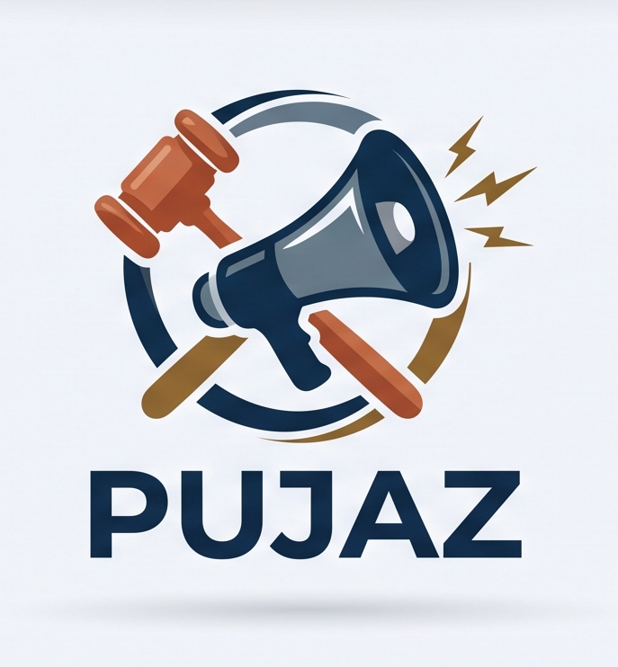
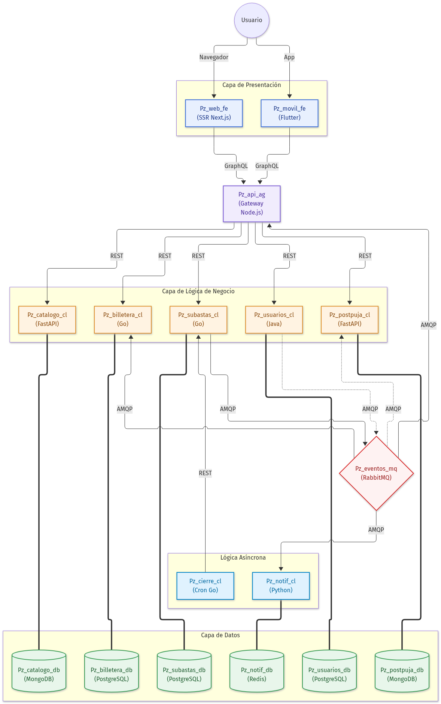
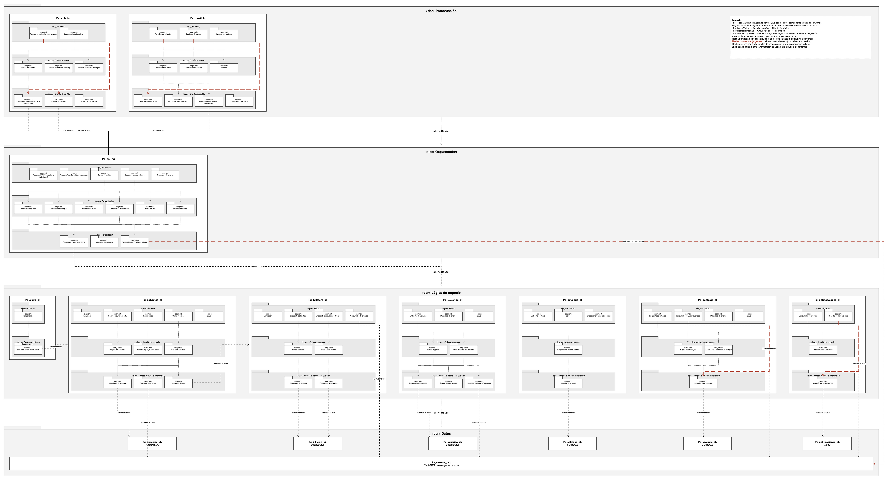
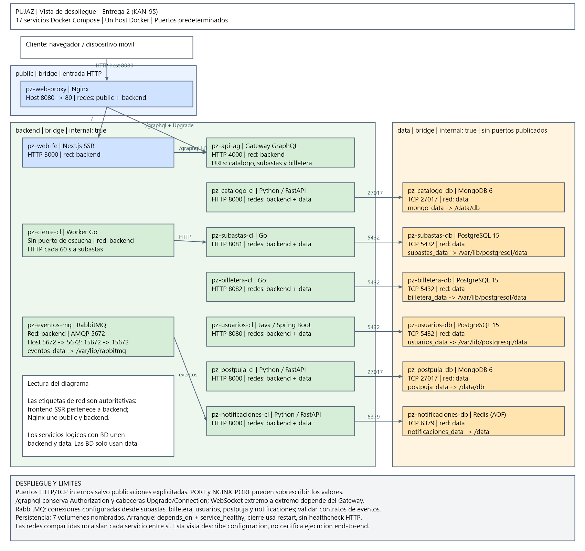
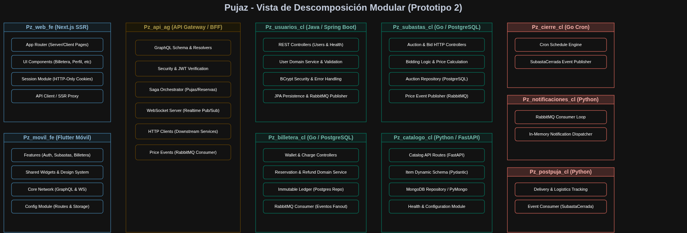
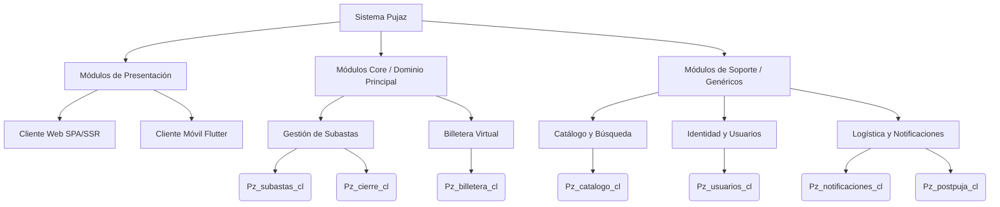

# Prototipo 2: Arquitectura Avanzada

## 1. Equipo

Nombre del equipo: 1C

Integrantes:
- María Catalina Rodríguez Cardona
- David Alejandro Sepúlveda Amaya
- Heider Hailober Navarro Quintero
- Frank Kenner Olmos Prada
- Yeiner Arwawingumu Zapata Vallejo
- Adrián Alberto Diosa Benavides

## 2. Sistema

Nombre: Pujaz

<p align="center"></p>

### Descripción
Pujaz es una plataforma distribuida para subastas en línea. Permite a los usuarios registrarse, explorar un catálogo de piezas de arte y coleccionables, recargar una billetera virtual, y pujar en tiempo real. En este segundo prototipo se incorporan patrones avanzados como Server-Side Rendering (SSR), arquitecturas dirigidas por eventos (RabbitMQ), patrón Saga para transacciones distribuidas, un API Gateway GraphQL y clientes móviles.

---

## 3. Estructuras Arquitectónicas

### 3.1 Vista de Componentes y Conectores (C&C)



La vista muestra los elementos del sistema que tienen presencia en tiempo de ejecución: los componentes y conectores. Tiene 17 componentes en total:
- 2 componentes de presentación (Pz_web_fe y Pz_movil_fe).
- 8 componentes lógicos (API Gateway, usuarios, subastas, catálogo, billetera, notificaciones, cierre, postpuja).
- 6 componentes de datos (3 PostgreSQL, 2 MongoDB, 1 Redis).
- 1 orquestador de eventos (Pz_eventos_mq, RabbitMQ).

**Estilos y Patrones Arquitectónicos:**
1. **Microservicios (Microservices Pattern):** La lógica de negocio está dividida en servicios autónomos, cada uno con su propia base de datos, garantizando la independencia y escalabilidad.
2. **Server-Side Rendering (SSR):** El frontend web (`Pz_web_fe`) utiliza SSR con Next.js (App Router) para pre-renderizar las vistas pesadas (como el catálogo) en el servidor antes de enviarlas al cliente, mejorando el SEO y los tiempos de carga inicial.
3. **API Gateway Pattern:** El componente `Pz_api_ag` centraliza las peticiones del frontend y el móvil, orquesta el llamado a múltiples microservicios (Backend For Frontend - BFF), gestiona el esquema unificado de GraphQL y maneja las conexiones WebSocket.
4. **Saga Pattern (Coreografía y Orquestación):** Las pujas se realizan bajo el patrón Saga orquestado por el Gateway. Este hace una reserva en la billetera, emite la puja en subastas, y en caso de error o de sobre-puja, emite transacciones compensatorias.
5. **Arquitectura Dirigida por Eventos (Event-Driven Architecture):** Se utiliza RabbitMQ (`Pz_eventos_mq`) con el patrón *Pub/Sub*. Cuando una subasta se cierra o hay una nueva puja, se publican eventos que los microservicios de Notificaciones, Postpuja y Billetera consumen asíncronamente de forma desacoplada.

### 3.2 Vista de Capas (Layered Structure)



El sistema se divide lógicamente en tres capas principales con restricciones estrictas de *allowed-to-use* (una capa superior solo puede depender de la inferior, y nunca al revés).

1. **Capa de Presentación (Presentation):** Contiene a los clientes finales (`Pz_web_fe` y `Pz_movil_fe`). Se encargan exclusivamente de la Interfaz de Usuario (UI) y de enviar peticiones GraphQL.
2. **Capa Lógica (Business Logic):** Se subdivide en dos:
   - **Gateway (Edge):** `Pz_api_ag` actúa como barrera de entrada, validando seguridad (JWT), consolidando respuestas y rutando.
   - **Dominio (Microservicios):** Los siete servicios de backend (`usuarios`, `subastas`, `catalogo`, `billetera`, `cierre`, `notificaciones`, `postpuja`) y el broker de eventos (`Pz_eventos_mq`). Aquí reside toda la lógica empresarial (reservas, pujas, envíos).
3. **Capa de Datos (Data / Persistence):** Compuesta por las 6 bases de datos independientes. Cada una es operada únicamente por su microservicio dueño. Hay bases relacionales (PostgreSQL) para consistencia transaccional y bases NoSQL (MongoDB, Redis) para alta disponibilidad de lecturas/caché.

### 3.3 Vista de Despliegue (Deployment Structure)



El despliegue está completamente orientado a contenedores. Docker Compose orquesta 17 contenedores en una misma máquina host.

**Elementos y Nodos:**
- **Host Machine:** Computadora o servidor donde corre Docker.
- **Docker Engine:** Entorno de ejecución que encapsula y aísla los componentes.
- **Redes Virtuales:** 
  - `public`: Red externa que conecta el servidor Nginx (Reverse Proxy) y el API Gateway con el mundo exterior.
  - `backend`: Red privada por donde el Gateway se comunica por HTTP (REST) con los microservicios, y los microservicios se comunican con RabbitMQ.
  - `data`: Red privada aislada por donde cada microservicio se comunica con su respectivo motor de base de datos.
- **Volúmenes:** Volúmenes Docker gestionados localmente para persistir la data de PostgreSQL, MongoDB y Redis incluso si los contenedores se destruyen.

**Patrones de Despliegue:**
1. **Containerized Deployment:** Todo el entorno (desde el frontend hasta las bases de datos) está empaquetado en contenedores inmutables.
2. **Reverse Proxy:** `pz-web-proxy` (Nginx) se expone al puerto 8080 de la máquina host, sirviendo archivos estáticos del frontend o redirigiendo las peticiones dinámicas de GraphQL al contenedor del Gateway mediante enrutamiento inverso.

### 3.4 Vista de Descomposición (Decomposition Structure)



Esta vista describe la estructura de los módulos que componen el sistema, organizándolos de manera jerárquica en dominios funcionales (Bounded Contexts) según los principios de Diseño Orientado al Dominio (DDD).



**Elementos y Relaciones:**
- **Sistema Pujaz:** El sistema global, descompuesto en 3 agrupaciones lógicas.
- **Módulos de Presentación:** Agrupan a las interfaces de usuario. Interactúan directamente con el Gateway (que actúa como capa anticorrupción del backend).
- **Módulos Core (Dominio Principal):** Es el corazón competitivo del negocio de subastas. 
  - *Gestión de Subastas:* Contiene la lógica para pujar y cronometrar las subastas. Se descompone en el servicio HTTP de subastas y en el *Cron Job* (`Pz_cierre_cl`) que actúa cíclicamente para validar vencimientos.
  - *Billetera Virtual:* Módulo responsable de la consistencia contable del dinero, gestionando recargas, retenciones temporales por pujas, reintegros y cobros definitivos.
- **Módulos de Soporte:** Contextos funcionales que complementan el sistema.
  - *Identidad:* Registro y validación de usuarios y credenciales JWT.
  - *Catálogo:* Fichas descriptivas, categorías y metadatos de las obras de arte (agnóstico al concepto de la subasta temporal).
  - *Logística y Notificaciones:* Se activa de forma asíncrona una vez terminada una subasta exitosa. Despacha la pieza al ganador y envía correos electrónicos y alertas in-app al resto de usuarios.

**Patrones:**
1. **Bounded Context (DDD):** El modelo de "Usuario" no es uno solo gigante. El módulo de Identidad conoce su email/clave, el módulo de Billetera conoce su ID y su dinero, y el de Notificaciones conoce su ID y sus mensajes.
2. **Decomposition by Business Capability:** Los módulos están divididos estrictamente según la capacidad empresarial que resuelven (Cobros, Subastas, Identidad) y no según su tecnología subyacente.

---

## 4. Prototipo

1. **Descargar el repositorio:**

```bash
git clone https://github.com/heider88/Pujaz.git
cd Pujaz
```

2. **Crear y configurar variables de entorno:**

```bash
cp .env.example .env
```
(Edita `.env` para asignar un valor a `POSTGRES_PASSWORD` y `JWT_SECRET`).

3. **Desplegar la infraestructura orientada a contenedores:**

```bash
docker compose up --build -d
```

4. **Uso del Software:**
- El **Frontend Web (SSR)** estará disponible en: `http://localhost:8080`.
- Puedes iniciar sesión con `ana@correo.com` / `12345678`. Su billetera ya tiene una base recargada de saldo para realizar pruebas de pujas.

5. **Para detener y borrar la data de prueba (reset):**
```bash
docker compose down -v
```

## 5. Video de Presentación
[Enlace al video de YouTube/Drive aquí]
