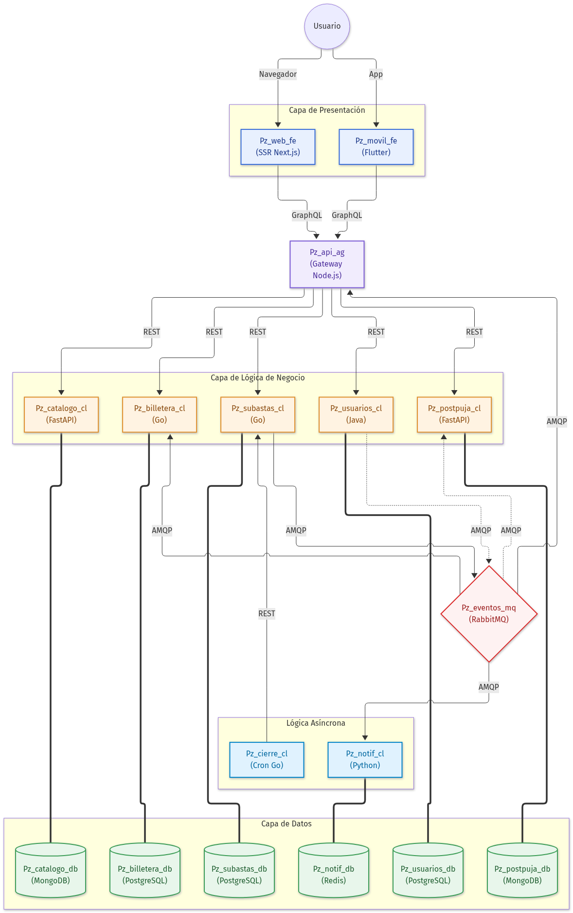

# Vista de componentes y conectores (C&C) · Pujaz

Esta vista presenta los elementos del sistema que tienen presencia en tiempo de ejecución: los componentes, que son los elementos de cómputo y de almacenamiento de datos, y los conectores, que son los caminos de interacción entre ellos. 

*El diagrama editable está en [vista-cc.drawio](vista-cc.drawio).*

En la Entrega 2, el sistema ha pasado de tener 6 a **17 componentes**, distribuidos así: 2 de presentación, 8 de lógica (incluido el gateway), 1 broker de eventos y 6 de datos.

Para nombrarlos usamos la convención `Pz_nombre_categoría`, de modo que el nombre indique la función principal del componente, y la categoría defina su rol general en la arquitectura: `fe` (front-end), `ag` (API gateway), `cl` (componente de lógica), `db` (base de datos) o `mq` (cola de mensajes / broker).

Usamos cuatro tipos de conectores principales:

1. **GraphQL (HTTP y WebSocket):** Entre los Front-ends y el Gateway.
2. **REST sobre HTTP:** Usado por el Gateway para orquestar a los microservicios, y por `Pz_cierre_cl` para comunicarse con `Pz_subastas_cl`.
3. **Database Connection:** Para la comunicación interna y privada de cada microservicio con su base de datos asignada (patrón de Database per Service).
4. **AMQP:** Entre los microservicios y RabbitMQ para la publicación y el consumo asíncrono de eventos de dominio (Coreografía del patrón Saga).

## Elementos y relaciones

### Componentes

| Componente | Tipo | Tecnología | Responsabilidad |
|---|---|---|---|
| Pz_web_fe | Presentación web | TypeScript, Next.js | Aplicación con Server-Side Rendering (SSR). Muestra listado, detalle, perfil y billetera. Corre parcialmente en servidor (Node) y en navegador (React). |
| Pz_movil_fe | Presentación móvil | Dart (Flutter) | App móvil para usuarios. Maneja login, catálogo, detalle, pujas y precio en vivo. Corre en el celular del usuario. |
| Pz_api_ag | Lógica (Orquestador) | TypeScript, Node.js | Gateway GraphQL (API Gateway). Único punto de entrada. Valida JWT, orquesta las llamadas REST (patrón Saga) y expone WebSocket para notificaciones. |
| Pz_subastas_cl | Lógica | Go | Lógica core de subastas: publicación, bloqueo en tiempo de puja, validación del monto, y cierre de la subasta. |
| Pz_billetera_cl | Lógica | Go | Manejo financiero: saldo disponible y reservado, recargas, reservas en pujas, reintegros y cobro al ganador. |
| Pz_usuarios_cl | Lógica | Java (Spring Boot) | Identidad y acceso: registro, inicio de sesión, credenciales, información de perfil y asignación de roles. |
| Pz_catalogo_cl | Lógica | Python (FastAPI) | Gestión de inventario de piezas, sus fichas, fotos, documentos y el motor de búsqueda indexada. |
| Pz_postpuja_cl | Lógica | Python (FastAPI) | Gestión logística: confirmación de datos de entrega post-subasta y seguimiento de envío de piezas ganadas. |
| Pz_notificaciones_cl | Lógica asíncrona | Python | Servicio para disparar notificaciones en tiempo real al usuario (vencimientos, superación de puja, resultado final). |
| Pz_cierre_cl | Lógica asíncrona | Go | Tarea programada (Cron) sin estado. Su única función es despertar cada minuto y decirle a `Pz_subastas_cl` que evalúe y cierre las subastas vencidas. |
| Pz_eventos_mq | Comunicación | RabbitMQ | Message Broker para comunicación asíncrona mediante el protocolo AMQP. Transporta eventos como `UsuarioRegistrado`, `PujaSuperada` y `SubastaCerrada`. |
| Pz_subastas_db | Datos (Relacional) | PostgreSQL | Base de datos para `Pz_subastas_cl` (Tablas: auctions, bids). |
| Pz_billetera_db | Datos (Relacional) | PostgreSQL | Base de datos para `Pz_billetera_cl` (Tablas: wallets, wallet_movements). |
| Pz_usuarios_db | Datos (Relacional) | PostgreSQL | Base de datos para `Pz_usuarios_cl` (Tablas: users, credentials). |
| Pz_catalogo_db | Datos (NoSQL) | MongoDB | Base de datos para `Pz_catalogo_cl` (Documentos: items, files). |
| Pz_postpuja_db | Datos (NoSQL) | MongoDB | Base de datos para `Pz_postpuja_cl` (Documentos: deliveries, statuses). |
| Pz_notificaciones_db | Datos (En Memoria) | Redis | Almacén rápido para gestionar el estado y la entrega efímera de notificaciones en `Pz_notificaciones_cl`. |

*(Nota: En tiempo de ejecución todos los componentes corren en contenedores Docker independientes, a excepción de `Pz_movil_fe` y la porción cliente de `Pz_web_fe` que se ejecutan en los dispositivos finales).*

### Conectores principales

| Conector | Origen (Cliente) | Destino (Servidor) | Propósito / Uso |
|---|---|---|---|
| **GraphQL** | `Pz_web_fe` / `Pz_movil_fe` | `Pz_api_ag` | Ejecutar operaciones (Queries y Mutations) por HTTP, y mantener una conexión WebSocket para escuchar la actualización del precio en vivo (`PrecioActualizado`). |
| **REST (HTTP)** | `Pz_api_ag` | Microservicios de Lógica (`Pz_subastas_cl`, `Pz_billetera_cl`, `Pz_usuarios_cl`, `Pz_catalogo_cl`, `Pz_postpuja_cl`, `Pz_notificaciones_cl`) | Orquestación síncrona. El gateway actúa como cliente de todos los microservicios para delegar lecturas o escrituras. |
| **REST (HTTP)** | `Pz_cierre_cl` | `Pz_subastas_cl` | Petición síncrona temporizada para detonar la validación y cierre de piezas. |
| **Database Connection** | Componentes de Lógica (`*_cl`) | Su respectiva DB asociada (`*_db`) | Conexión directa y exclusiva entre un servicio y su propia base de datos (Ej. `Pz_billetera_cl` ↔ `Pz_billetera_db`). |

### Conectores asíncronos (Broker de Eventos)

La coreografía orientada a eventos para la Saga de la puja ocurre usando `Pz_eventos_mq` (RabbitMQ) como intermediario. La relación de publicación y consumo es:

| Evento | Publicado por | Consumido por | Finalidad |
|---|---|---|---|
| `UsuarioRegistrado` | `Pz_usuarios_cl` | `Pz_billetera_cl` | Crear una billetera inicial y vacía para el nuevo usuario. |
| `PujaSuperada` | `Pz_subastas_cl` | `Pz_billetera_cl`, `Pz_notificaciones_cl` | Liberar (reintegro) la reserva de dinero al postor anterior, y notificarle en pantalla que lo superaron. |
| `PrecioActualizado` | `Pz_subastas_cl` | `Pz_api_ag` | Enviar el precio más reciente por WebSocket a todos los usuarios conectados viendo la pieza. |
| `SubastaCerrada` | `Pz_subastas_cl` | `Pz_billetera_cl`, `Pz_postpuja_cl`, `Pz_notificaciones_cl` | Hacer el cobro definitivo al ganador (billetera), iniciar el flujo de entrega de la pieza (postpuja) y avisar a vendedor y comprador (notificaciones). |

### Relaciones Clave y Reglas Arquitectónicas

1. **Aislamiento de la Interfaz:** Los Front-ends (`Pz_web_fe`, `Pz_movil_fe`) no conocen en absoluto la existencia de los microservicios. Ellos asumen que el Gateway (`Pz_api_ag`) es todo el backend de Pujaz.
2. **Database per Service:** Un microservicio tiene tajantemente prohibido conectarse a la base de datos de otro. Por ejemplo, `Pz_cierre_cl` no toca a `Pz_subastas_db`; en lugar de eso le pide a `Pz_subastas_cl` por REST que lo haga.
3. **Orquestación y Coreografía (Patrón Saga):** 
   - El Gateway actúa de forma *orquestada* y síncrona en el "momento cero" de la puja: valida al usuario y retiene el dinero en billetera. Si la reserva falla, aborta y rechaza la puja inmediatamente en pantalla. 
   - Posteriormente, cuando la puja es validada con éxito o superada por otra, el sistema se comporta de forma *coreografiada* y asíncrona: publica los eventos en RabbitMQ para que otros servicios hagan los reintegros o emitan notificaciones en el fondo sin bloquear la respuesta principal al postor actual.
