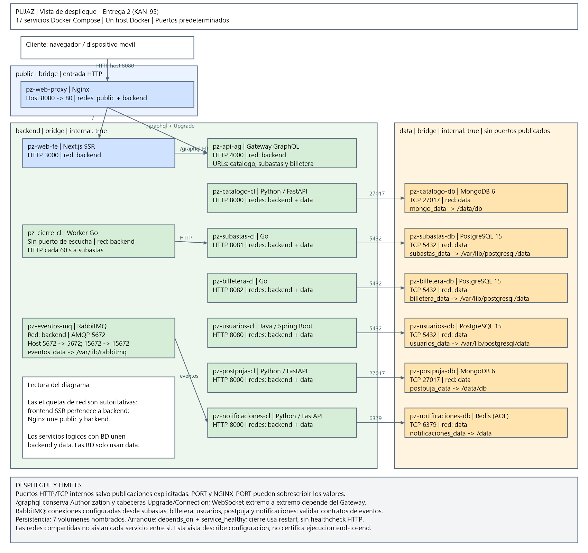

# Vista de Despliegue — Pujaz (KAN-95)

## 1. Introducción

La Entrega 2 de Pujaz se despliega mediante contenedores Docker coordinados por el archivo raíz `docker-compose.yml`. Compose define 17 servicios, sus imágenes o contextos de construcción, variables de entorno, redes, volúmenes y dependencias de arranque. Este modelo describe un despliegue sobre un host Docker; no configura un clúster ni alta disponibilidad.

Los nombres de esta vista corresponden a los servicios actuales de Compose. El antiguo componente transaccional se representa mediante servicios separados de usuarios, subastas y billetera; no existe un contenedor adicional denominado `ms-transaccional`. El frontend desplegado es Next.js con SSR (`pz-web-fe`).

## 2. Segmentación de redes e infraestructura

### Red `public`

Red `bridge` de entrada para Nginx (`pz-web-proxy`), único servicio conectado a ella. El cliente accede al puerto del host `${NGINX_PORT:-8080}`, publicado hacia el puerto 80 del contenedor. Nginx también pertenece a `backend` para alcanzar el frontend y el Gateway.

La configuración actual proporciona HTTP. No declara puerto 443, certificados ni terminación TLS; HTTPS requeriría configurar TLS en Nginx o un terminador externo.

### Red `backend`

Red `bridge` privada con `internal: true`. Conecta Nginx, el frontend SSR, el API Gateway, los servicios lógicos, el worker de cierre y RabbitMQ. Los servicios se localizan mediante sus nombres DNS de Compose.

RabbitMQ declara además publicaciones de puertos en el host: 5672 para AMQP y 15672 para administración HTTP. Estas publicaciones deben distinguirse de la pertenencia a la red privada; `backend` no implica que Compose omita puertos publicados. Su accesibilidad efectiva depende de Docker y de las reglas de red del host.

### Red `data`

Red `bridge` aislada con `internal: true`, destinada a PostgreSQL, MongoDB y Redis. Las bases de datos pertenecen únicamente a esta red y no publican puertos al host. Los servicios que necesitan persistencia pertenecen tanto a `backend` como a `data`.

El aislamiento es por capa: los miembros de `data` comparten conectividad entre sí. No existen redes individuales por base de datos ni reglas de autorización entre servicios definidas por Compose.

## 3. Componentes y despliegue

En la tabla, `host → contenedor` indica una publicación mediante `ports`. «Interno» identifica el puerto de escucha dentro de Docker, sin publicación al host. Los valores corresponden a los predeterminados del Compose; las variables de entorno pueden sobrescribirlos. Los nombres mostrados son identificadores de servicio, no nombres fijos de contenedor.

| Contenedor / Servicio | Red(es) | Puertos Expuestos | Volumen Persistente | Descripción |
| --- | --- | --- | --- | --- |
| `pz-web-proxy` | `public`, `backend` | Host `8080 → 80` HTTP; host configurable con `NGINX_PORT` | Ninguno; plantilla Nginx montada en solo lectura | Nginx: entrada web, proxy `/` al frontend y `/graphql` al Gateway. |
| `pz-web-fe` | `backend` | Interno `3000` HTTP | Ninguno | Frontend Next.js con renderizado en servidor. |
| `pz-api-ag` | `backend` | Interno `4000` HTTP/GraphQL, configurable con `PORT` | Ninguno | API Gateway: entrada GraphQL y acceso a servicios de catálogo, subastas y billetera. |
| `pz-usuarios-db` | `data` | Interno `5432` PostgreSQL | `usuarios_data:/var/lib/postgresql/data` | PostgreSQL 15 para usuarios. |
| `pz-subastas-db` | `data` | Interno `5432` PostgreSQL | `subastas_data:/var/lib/postgresql/data` | PostgreSQL 15 para subastas. |
| `pz-billetera-db` | `data` | Interno `5432` PostgreSQL | `billetera_data:/var/lib/postgresql/data` | PostgreSQL 15 para billetera. |
| `pz-catalogo-db` | `data` | Interno `27017` MongoDB | `mongo_data:/data/db` | MongoDB 6 para catálogo. |
| `pz-catalogo-cl` | `backend`, `data` | Interno `8000` HTTP | Ninguno | API de catálogo en Python/FastAPI, conectada a MongoDB. |
| `pz-postpuja-db` | `data` | Interno `27017` MongoDB | `postpuja_data:/data/db` | MongoDB 6 para el procesamiento posterior a la puja. |
| `pz-postpuja-cl` | `backend`, `data` | Interno `8000` HTTP | Ninguno | Servicio de postpuja con conexiones a RabbitMQ y MongoDB. |
| `pz-notificaciones-db` | `data` | Interno `6379` Redis | `notificaciones_data:/data` | Redis con persistencia AOF habilitada para notificaciones. |
| `pz-eventos-mq` | `backend` | Host `5672 → 5672` AMQP y `15672 → 15672` HTTP de administración | `eventos_data:/var/lib/rabbitmq` | Broker RabbitMQ con complemento de administración. |
| `pz-subastas-cl` | `backend`, `data` | Interno `8081` HTTP | Ninguno | Servicio Go de subastas, con PostgreSQL y publicación de eventos. |
| `pz-usuarios-cl` | `backend`, `data` | Interno `8080` HTTP | Ninguno | Servicio Java/Spring Boot de usuarios, conectado a PostgreSQL. |
| `pz-billetera-cl` | `backend`, `data` | Interno `8082` HTTP | Ninguno | Servicio Go de billetera, conectado a PostgreSQL y RabbitMQ. |
| `pz-cierre-cl` | `backend` | Ninguno; worker sin servidor HTTP | Ninguno | Worker Go que solicita periódicamente el cierre de subastas vencidas a `pz-subastas-cl:8081`. |
| `pz-notificaciones-cl` | `backend`, `data` | Interno `8000` HTTP | Ninguno | Consumidor Python de eventos de RabbitMQ; guarda avisos en Redis y ofrece consulta REST. |

Los siete volúmenes nombrados conservan datos al recrear contenedores, mientras no se eliminen explícitamente. No sustituyen una política de copias de seguridad. PostgreSQL monta únicamente scripts `.up.sql` de esquema y datos iniciales; estos se ejecutan al inicializar un directorio de datos vacío. Cambiar las variables `POSTGRES_USUARIOS_DB`, `POSTGRES_SUBASTAS_DB` o `POSTGRES_BILLETERA_DB` no renombra bases existentes en los volúmenes.

### Salud y orden de arranque

Compose utiliza `depends_on` con `condition: service_healthy` para esperar las dependencias declaradas:

- Los servicios con persistencia esperan sus bases; los consumidores y productores correspondientes esperan RabbitMQ.
- Notificaciones espera RabbitMQ y Redis. Subastas espera PostgreSQL, RabbitMQ, billetera y notificaciones.
- El worker de cierre espera a subastas; el Gateway espera catálogo, subastas y billetera.
- El frontend espera al Gateway; Nginx espera al frontend y al Gateway.

Hay healthchecks HTTP, GraphQL o nativos según el servicio. `pz-cierre-cl` no tiene healthcheck HTTP porque no ofrece un servidor; usa `restart: unless-stopped`, al igual que notificaciones. Una política de reinicio recupera un proceso que termina, pero no detecta un proceso bloqueado. Las condiciones de arranque no garantizan disponibilidad continua ni validan por sí solas los flujos de negocio completos.

## 4. Patrones arquitectónicos aplicados

### Proxy inverso (Edge Routing)

Nginx centraliza el ingreso HTTP. Envía `/` a `pz-web-fe:3000` y la ruta exacta `/graphql` a `pz-api-ag` en el puerto configurado. Transmite `Host`, `X-Real-IP` y cabeceras de reenvío; para GraphQL conserva `Authorization` e incluye `Upgrade` y `Connection`. Estas cabeceras preparan el transporte WebSocket, pero su funcionamiento extremo a extremo requiere soporte del servidor GraphQL.

### Gateway Routing/Aggregation

El Gateway proporciona una interfaz GraphQL para los clientes y concentra el acceso a los servicios internos. Compose configura las URLs de catálogo, subastas y billetera, así como JWT y CORS mediante variables de entorno. `USE_MOCKS` tiene valor predeterminado `false` en el Compose actual, aunque el entorno puede sobrescribirlo. La agregación efectiva depende de los resolvers y clientes implementados.

### Pub/Sub asíncrono

RabbitMQ desacopla productores y consumidores de eventos. El servicio de notificaciones procesa `PujaSuperada` y `SubastaCerrada`, persiste avisos por usuario en Redis y permite consultarlos mediante REST. El worker de cierre actúa como disparador periódico por HTTP; no es un consumidor de RabbitMQ.

La conectividad y la salud del broker no demuestran compatibilidad entre contratos de eventos. La validación funcional requiere comprobar exchanges, colas, claves de enrutamiento y payloads de cada productor y consumidor, incluido postpuja.

### Isolation / Data Tiering

Las redes separan entrada, lógica y persistencia. Nginx une `public` con `backend`; los servicios con almacenamiento unen `backend` con `data`. Las bases no publican puertos al host y tienen volúmenes independientes. Esta separación reduce el acceso directo a la capa de datos, sin reemplazar autenticación, autorización o controles de red adicionales.

## 5. Diagrama de despliegue

El diagrama representa estos 17 servicios, sus redes, publicaciones de puertos y volúmenes. El archivo editable es [vista-despliegue.drawio](./vista-despliegue.drawio), ubicado junto a este documento. Las etiquetas indican todas las redes de cada servicio; las flechas muestran rutas seleccionadas de comunicación, no el grafo completo de dependencias de arranque.

**Artefactos:** se incluyen `vista-despliegue.png` y `vista-despliegue.drawio`. Los valores mostrados corresponden a los predeterminados de Compose; la imagen no implica que se haya validado un despliegue completo.
