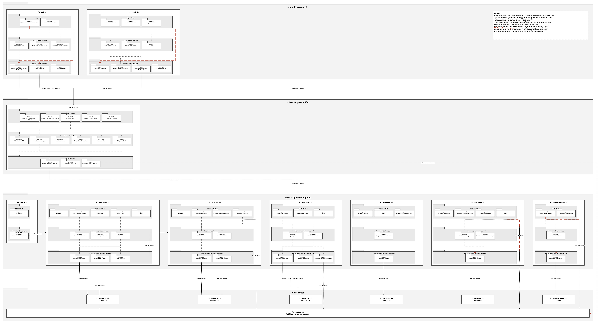

# Vista de capas - Pujaz

## Descripción

Esta vista muestra la **estructura en capas** de Pujaz: grupos de piezas del sistema que ofrecen un conjunto coherente de servicios, unidos por una relación *allowed-to-use* en un solo sentido. Usa los nombres de componentes de la [vista C&C](vista-cc.md).

**Elementos**

| Elemento | Qué es en Pujaz |
|---|---|
| **Tier** | Separación física: dónde corre cada componente. Hay 4 tiers. |
| **Layer** | Separación lógica dentro de un componente. Sus nombres dependen del tipo de componente (sección 2). |
| **Layer segment** | Una pieza dentro de una layer, nombrada por lo que hace. |

**Relaciones** (especializaciones de *depends-on*)

| Relación | Regla |
|---|---|
| ***allowed-to-use*** | Se puede usar **solo la capa inmediatamente inferior**, o una pieza o componente vecino de la misma capa. |
| ***allowed-to-use-below*** | Se puede usar **cualquier capa inferior**, aunque se salte una. |

**Restricciones**
- Cada pieza de software está en exactamente una layer.
- Hay al menos dos layers.
- Las relaciones no son circulares: una capa inferior nunca usa a una superior.

## Diagrama

El fuente editable está en [vista_capas.drawio](vista_capas.drawio).

**Cómo leerlo**
- **Flecha punteada gris fina:** *allowed-to-use* entre piezas.
- **Flecha punteada roja gruesa:** *allowed-to-use-below*. Baja por el costado derecho del componente, para no cruzar sobre otras piezas.
- **Flechas negras con texto:** salidas de un componente hacia otro y relaciones entre tiers.
- **Las piezas de una misma layer también se usan entre sí** (por ejemplo, el enrutador llama a cada endpoint). Para que el diagrama se lea, esas flechas no se dibujan; están en las tablas de abajo.
- **Las flechas indican quién usa a quién.** Cuando un evento llega por el broker, la flecha va desde la pieza que se suscribe (el consumidor) hacia Pz_eventos_mq, aunque el evento *entre* por ahí.

## 1. Tiers

| Tier | Qué agrupa | Dónde corre |
|---|---|---|
| Presentación | Pz_web_fe, Pz_movil_fe | Navegador y servidor web; celular del usuario |
| Orquestación | Pz_api_ag | Contenedor propio en la red interna |
| Lógica de negocio | Pz_subastas_cl, Pz_billetera_cl, Pz_usuarios_cl, Pz_catalogo_cl, Pz_postpuja_cl, Pz_notificaciones_cl, Pz_cierre_cl | Un contenedor por componente en la red interna |
| Datos | Pz_subastas_db, Pz_billetera_db, Pz_usuarios_db, Pz_catalogo_db, Pz_postpuja_db, Pz_notificaciones_db, Pz_eventos_mq | Un contenedor por base y el broker, en la red interna |

| Desde | Hacia | Relación | Por qué |
|---|---|---|---|
| Presentación | Orquestación | *allowed-to-use* | La web y la móvil solo hablan con Pz_api_ag. |
| Orquestación | Lógica de negocio | *allowed-to-use* | Pz_api_ag llama a los microservicios. |
| Lógica de negocio | Datos | *allowed-to-use* | Cada microservicio usa su propia base y el broker. |
| Pz_api_ag | Pz_eventos_mq | *allowed-to-use-below* | El gateway recibe `PrecioActualizado` para el precio en vivo. Se salta el tier de Lógica de negocio. |
| Pz_cierre_cl | Pz_subastas_cl | *allowed-to-use* (componentes vecinos) | El cierre pide a subastas que cierre las vencidas. |
| Pz_subastas_cl | Pz_billetera_cl | *allowed-to-use* (componentes vecinos) | Hoy subastas reserva en la billetera al pujar. Según el contrato v3 eso pasa al gateway y esta relación desaparece. |

### Dónde va Pz_eventos_mq y por qué

Pz_eventos_mq va en el tier **Datos**:
1. **Es un proceso físico aparte sin lógica de negocio:** recibe, guarda en colas durables y entrega mensajes. Cumple el mismo papel que una base de datos: la usan los servicios y no decide nada.
2. **Mantiene la regla estricta en casi todo el sistema:** cada microservicio usa sus bases y el broker con *allowed-to-use*. Si el broker tuviera un tier propio entre Lógica de negocio y Datos, todos los usos de microservicio → base pasarían a ser *allowed-to-use-below*.
3. **Deja una sola excepción, explícita:** Pz_api_ag → Pz_eventos_mq, que es *allowed-to-use-below*.
4. **No va en Lógica de negocio:** ahí sería un componente usado de forma lateral por todos, aunque no tiene lógica.

## 2. Layers según el tipo de componente

| Tipo | Componentes | Layers (de arriba hacia abajo) |
|---|---|---|
| Front-end | Pz_web_fe, Pz_movil_fe | **Vistas** → **Estado y sesión** → **Cliente GraphQL** |
| Orquestador | Pz_api_ag | **Interfaz** → **Orquestación** → **Integración** |
| Microservicio y worker | Pz_subastas_cl, Pz_billetera_cl, Pz_usuarios_cl, Pz_catalogo_cl, Pz_postpuja_cl, Pz_notificaciones_cl | **Interfaz** → **Lógica de negocio** → **Acceso a datos e integración** |
| Worker sin lógica propia | Pz_cierre_cl | **Interfaz** → **Acceso a datos e integración** |

- **Vistas:** las pantallas que ve el usuario.
- **Estado y sesión:** la sesión del usuario y lo que las pantallas comparten.
- **Cliente GraphQL:** la comunicación con el gateway.
- **Interfaz:** recibe las peticiones o los eventos y responde.
- **Orquestación:** coordina a varios microservicios para atender una sola operación.
- **Lógica de negocio:** las reglas del componente.
- **Integración** (gateway): habla con los microservicios y el broker; el gateway no tiene base propia.
- **Acceso a datos e integración:** habla con su base (datos) y con el broker u otros servicios (integración).

## 3. Piezas de cada componente

En cada tabla, **"Usa a"** dice a qué pieza pasa la petición: en la misma layer, en la de abajo o fuera del componente.

### 3.1 Pz_web_fe · front-end

| Layer | Pieza | Qué hace | Usa a |
|---|---|---|---|
| Vistas | Páginas renderizadas en el servidor | Arman cada página (catálogo, detalle, login, registro, perfil, billetera, publicar) antes de enviarla al navegador. | Componentes interactivos; Cliente del servidor (*below*) |
| Vistas | Componentes interactivos | Formularios de login, registro, puja y publicación; panel de subasta, galería y cuenta regresiva. | Sesión del usuario; Formato; Cliente del navegador (*below*) |
| Estado y sesión | Sesión del usuario | Sabe quién inició sesión y lo comparte con los componentes. | Acciones del servidor; Cliente del navegador |
| Estado y sesión | Acciones del servidor | Guardan y borran la cookie de sesión. | — |
| Estado y sesión | Formato de precios y tiempos | Muestra montos en pesos y el tiempo restante. | — |
| Cliente GraphQL | Cliente del navegador | Envía consultas y mutaciones por HTTP y abre la suscripción por WebSocket. | Traducción de errores; **sale a Pz_api_ag** |
| Cliente GraphQL | Cliente del servidor | Consulta al gateway desde el servidor web para armar las páginas. | Traducción de errores; **sale a Pz_api_ag** |
| Cliente GraphQL | Traducción de errores | Convierte los códigos del contrato en mensajes para el usuario. | — |

**Recorrido de una puja:** *Componentes interactivos* (formulario de puja) → *Sesión del usuario* → *Cliente del navegador* → sale a **Pz_api_ag**.

### 3.2 Pz_movil_fe · front-end

| Layer | Pieza | Qué hace | Usa a |
|---|---|---|---|
| Vistas | Pantallas de subastas | Lista y detalle de las subastas, con la puja. | Widgets compartidos; Traducción de errores; Formato; Consultas y mutaciones (*below*) |
| Vistas | Pantallas de cuenta | Login, registro, perfil y billetera. | Widgets compartidos; Controlador de sesión; Consultas y mutaciones (*below*) |
| Vistas | Widgets compartidos | La estructura común de las pantallas. | — |
| Estado y sesión | Controlador de sesión | Inicia y cierra sesión y guarda el token de forma segura. | Repositorio de autenticación; Cliente GraphQL |
| Estado y sesión | Traducción de errores | Convierte los códigos del contrato en mensajes. | — |
| Estado y sesión | Formato | Montos y fechas para mostrar. | — |
| Cliente GraphQL | Consultas y mutaciones | Las operaciones GraphQL que usa la app. | — |
| Cliente GraphQL | Repositorio de autenticación | Login y registro contra el gateway. | Consultas y mutaciones |
| Cliente GraphQL | Cliente GraphQL | Conexión HTTP y WebSocket con el gateway. | Configuración de URLs; **sale a Pz_api_ag** |
| Cliente GraphQL | Configuración de URLs | Las direcciones del gateway según el ambiente. | — |

**Recorrido de un inicio de sesión:** *Pantallas de cuenta* → *Controlador de sesión* → *Repositorio de autenticación* → *Consultas y mutaciones* y *Cliente GraphQL* → sale a **Pz_api_ag**.

### 3.3 Pz_api_ag · orquestador

| Layer | Pieza | Qué hace | Usa a |
|---|---|---|---|
| Interfaz | Receptor HTTP | Recibe consultas y mutaciones GraphQL. | Control de sesión; Despacho de operaciones; Traducción de errores |
| Interfaz | Receptor WebSocket | Mantiene abiertas las suscripciones `auctionUpdated`. | Despacho de operaciones |
| Interfaz | Control de sesión | Lee el token (encabezado o cookie) y exige sesión en las operaciones protegidas. | Autenticación |
| Interfaz | Despacho de operaciones | Lleva cada operación GraphQL a su coordinador. | Las seis piezas de Orquestación |
| Interfaz | Traducción de errores | Todo error sale con un código permitido; la causa solo va al log. | — |
| Orquestación | Autenticación | Firma el token tras el login o el registro y verifica que el usuario del token siga existiendo. | Clientes de los microservicios |
| Orquestación | Coordinación de la puja | Reserva en billetera → puja en subastas → libera la reserva si la puja falla; libera la reserva anterior si el usuario sube su propia puja. | Clientes de los microservicios |
| Orquestación | Creación de ítems | Crea el ítem en catálogo y después su subasta en subastas. | Clientes de los microservicios |
| Orquestación | Composición de consultas | Junta datos de varios servicios en una respuesta (un ítem con su subasta, una entrega con su subasta…) con una sola llamada por servicio. | Clientes de los microservicios |
| Orquestación | Precio en vivo | Por cada `PrecioActualizado`, relee la subasta y la reparte a los suscriptores. | Clientes de los microservicios; Consumidor de PrecioActualizado |
| Orquestación | Delegación directa | Pasa la llamada a un solo microservicio, sin combinar nada (perfil, recarga, confirmar entrega). | Clientes de los microservicios |
| Integración | Clientes de los microservicios | Llaman por REST a usuarios, subastas, billetera, catálogo, postpuja y notificaciones. | Validación del contrato; **sale al tier Lógica de negocio** |
| Integración | Validación del contrato | Revisa que cada respuesta cumpla `rest.md` antes de dejarla pasar. | — |
| Integración | Consumidor de PrecioActualizado | Cola propia en el broker por cada copia del gateway. | **sale a Pz_eventos_mq** (*below*) |

**Recorrido de una puja:** *Receptor HTTP* → *Control de sesión* → *Despacho de operaciones* → *Coordinación de la puja* → *Clientes de los microservicios* → sale a **Pz_usuarios_cl** (nombre del postor), **Pz_billetera_cl** (reserva) y **Pz_subastas_cl** (puja).

**Recorrido del precio en vivo:** el evento entra por *Consumidor de PrecioActualizado* → *Precio en vivo* relee la subasta con *Clientes de los microservicios* → la envía por *Receptor WebSocket* a los suscriptores.

### 3.4 Pz_subastas_cl · microservicio

| Layer | Pieza | Qué hace | Usa a |
|---|---|---|---|
| Interfaz | Enrutador | Lleva cada petición a su endpoint. | Los cuatro endpoints |
| Interfaz | Crear y consultar subastas | Crear una subasta y consultarla por id o por ítem. | Registro de subastas |
| Interfaz | Recibir pujas | Recibe una puja. | Validación y registro de pujas |
| Interfaz | Cerrar vencidas | Lo llama Pz_cierre_cl cada cierto tiempo. | Cierre de subastas |
| Interfaz | Salud | Responde si el servicio está vivo. | — |
| Lógica de negocio | Registro de subastas | Crea subastas y calcula si están abiertas o cerradas. | Repositorio de subastas |
| Lógica de negocio | Validación y registro de pujas | Subasta abierta y al menos 100 sobre el precio actual; registra la puja y avisa. | Repositorio de subastas; Publicador de eventos; Cliente de billetera |
| Lógica de negocio | Cierre de subastas | Cierra las vencidas y avisa quién ganó. | Repositorio de subastas; Publicador de eventos |
| Acceso a datos e integración | Repositorio de subastas | Lee y escribe subastas y pujas; bloquea la subasta mientras se puja. | **sale a Pz_subastas_db** |
| Acceso a datos e integración | Publicador de eventos | Publica `PujaSuperada`, `PrecioActualizado` y `SubastaCerrada`. | **sale a Pz_eventos_mq** |
| Acceso a datos e integración | Cliente de billetera | Reserva y reintegra saldo en la billetera. | **sale a Pz_billetera_cl** |

**Recorrido de una puja:** *Enrutador* → *Recibir pujas* → *Validación y registro de pujas* → *Repositorio de subastas* (sale a **Pz_subastas_db**) y *Publicador de eventos* (sale a **Pz_eventos_mq**).

### 3.5 Pz_billetera_cl · microservicio

| Layer | Pieza | Qué hace | Usa a |
|---|---|---|---|
| Interfaz | Enrutador | Lleva cada petición a su endpoint. | Endpoints de billetera; Endpoints de usuarios |
| Interfaz | Endpoints de billetera | Saldo, recarga, reservar y reintegrar. | Reglas de saldo |
| Interfaz | Endpoints de usuarios (entrega 1) | Registro, credenciales y perfil, heredados de la entrega 1. | Usuarios heredados |
| Interfaz | Consumidor de eventos | `PujaSuperada` → reintegro; `SubastaCerrada` → cobro. | Reglas de saldo; **sale a Pz_eventos_mq** |
| Lógica de negocio | Reglas de saldo | Recargar con código válido, reservar con saldo suficiente, reintegrar y cobrar. | Repositorio de billetera |
| Lógica de negocio | Usuarios heredados | Registro con billetera en 0 y verificación de contraseña. | Repositorio de usuarios |
| Acceso a datos e integración | Repositorio de billetera | Saldos y movimientos. | **sale a Pz_billetera_db** |
| Acceso a datos e integración | Repositorio de usuarios | Usuarios de la entrega 1. | **sale a Pz_billetera_db** |

**Recorrido de un reintegro:** el evento entra por *Consumidor de eventos* → *Reglas de saldo* → *Repositorio de billetera* → sale a **Pz_billetera_db**.

### 3.6 Pz_usuarios_cl · microservicio

| Layer | Pieza | Qué hace | Usa a |
|---|---|---|---|
| Interfaz | Endpoints de usuarios | Registro, login, perfil, edición y borrado. | Registro y perfil; Verificación de credenciales |
| Interfaz | Manejador de errores | Devuelve cada error con el formato del contrato. | — |
| Interfaz | Salud | Responde si el servicio está vivo. | — |
| Lógica de negocio | Registro y perfil | Valida los datos, asigna el rol y el estado de la cuenta. | Repositorio de usuarios; Cifrado de contraseñas; Publicador de UsuarioRegistrado |
| Lógica de negocio | Verificación de credenciales | Comprueba la contraseña y rechaza cuentas inactivas. | Repositorio de usuarios; Cifrado de contraseñas |
| Acceso a datos e integración | Repositorio de usuarios | Lee y escribe usuarios. | **sale a Pz_usuarios_db** |
| Acceso a datos e integración | Cifrado de contraseñas | Guarda y compara contraseñas cifradas. | — |
| Acceso a datos e integración | Publicador de UsuarioRegistrado | Avisa que se creó un usuario. | **sale a Pz_eventos_mq** |

**Recorrido de un registro:** *Endpoints de usuarios* → *Registro y perfil* → *Cifrado de contraseñas*, *Repositorio de usuarios* (sale a **Pz_usuarios_db**) y *Publicador de UsuarioRegistrado* (sale a **Pz_eventos_mq**).

### 3.7 Pz_catalogo_cl · microservicio

| Layer | Pieza | Qué hace | Usa a |
|---|---|---|---|
| Interfaz | Endpoints de ítems | Listar y buscar, ver el detalle y crear ítems. | Búsqueda y creación de ítems |
| Interfaz | Salud | Responde si el servicio está vivo. | — |
| Interfaz | Endpoint heredado | Devuelve una lista fija de artículos de ejemplo. | — |
| Lógica de negocio | Búsqueda y creación de ítems | Busca por texto, valida y crea ítems. | Repositorio de ítems |
| Acceso a datos e integración | Repositorio de ítems | Lee y escribe ítems. | **sale a Pz_catalogo_db** |

**Recorrido de una búsqueda:** *Endpoints de ítems* → *Búsqueda y creación de ítems* → *Repositorio de ítems* → sale a **Pz_catalogo_db**.

### 3.8 Pz_postpuja_cl · microservicio

| Layer | Pieza | Qué hace | Usa a |
|---|---|---|---|
| Interfaz | Endpoints de entregas | Mis entregas y confirmar una entrega. | Manejador de errores; Consulta y confirmación de entregas |
| Interfaz | Consumidor de SubastaCerrada | Recibe el cierre de cada subasta. | Registro de entregas; **sale a Pz_eventos_mq** |
| Interfaz | Manejador de errores | Devuelve cada error con el formato del contrato. | — |
| Interfaz | Salud | Responde si el servicio y su base están vivos. | Repositorio de entregas (*below*) |
| Lógica de negocio | Registro de entregas | Crea la entrega del ganador, una sola por subasta. | Repositorio de entregas |
| Lógica de negocio | Consulta y confirmación de entregas | Lista las entregas del usuario y confirma solo las suyas. | Repositorio de entregas |
| Acceso a datos e integración | Repositorio de entregas | Lee y escribe entregas, sin duplicar. | **sale a Pz_postpuja_db** |

**Recorrido de una subasta cerrada:** el evento entra por *Consumidor de SubastaCerrada* → *Registro de entregas* → *Repositorio de entregas* → sale a **Pz_postpuja_db**.

### 3.9 Pz_notificaciones_cl · worker

| Layer | Pieza | Qué hace | Usa a |
|---|---|---|---|
| Interfaz | Consumidor de eventos | Recibe `PujaSuperada` y `SubastaCerrada`. | Armado de la notificación; Almacén de notificaciones (*below*); **sale a Pz_eventos_mq** |
| Interfaz | Consulta de notificaciones | Devuelve las notificaciones de un usuario. | Almacén de notificaciones (*below*) |
| Lógica de negocio | Armado de la notificación | Decide el destinatario y el mensaje. | — |
| Acceso a datos e integración | Almacén de notificaciones | Guarda y lee las notificaciones. | **sale a Pz_notificaciones_db** |

**Recorrido de un evento:** entra por *Consumidor de eventos* → *Armado de la notificación* → el consumidor guarda con *Almacén de notificaciones* → sale a **Pz_notificaciones_db**.

### 3.10 Pz_cierre_cl · worker

| Layer | Pieza | Qué hace | Usa a |
|---|---|---|---|
| Interfaz | Temporizador | Se activa cada cierto tiempo. | Llamada de cierre a subastas |
| Acceso a datos e integración | Llamada de cierre a subastas | Pide a subastas que cierre las vencidas. | **sale a Pz_subastas_cl** |

**Recorrido:** *Temporizador* → *Llamada de cierre a subastas* → sale a **Pz_subastas_cl**.

## 4. Patrones

- **Estructura en capas:** el patrón de esta vista. Se usa de forma estricta (*allowed-to-use*) entre tiers y entre las layers de cada componente, y de forma relajada (*allowed-to-use-below*) solo en los casos marcados.
- **Cliente-servidor y SOFEA sobre microservicios** (ver [estilos arquitectónicos](estilos_arquitectonicos.md)): los tiers de Presentación, Orquestación y Lógica de negocio son la forma física de esos estilos. La presentación es un cliente separado y el gateway es el único servidor que ve.
- **El gateway como orquestador** (ver [vista C&C](vista-cc.md)): Pz_api_ag no tiene reglas de negocio propias; coordina a los microservicios. Por eso tiene su propio tier, **Orquestación**, y su capa del medio se llama Orquestación.

## 5. Restricciones y observaciones

| Restricción | ¿Se cumple? |
|---|---|
| Cada pieza en exactamente una layer | Sí. |
| Al menos dos layers | Sí: Pz_cierre_cl tiene dos y los demás tres. |
| Sin relaciones circulares | Sí: ninguna pieza usa a una de una capa superior. |

**Observaciones**
1. **Pz_notificaciones_cl y Pz_cierre_cl no separan su código en layers:** sus piezas están en uno o dos archivos. Aquí se muestran separadas por lo que hace cada parte. En notificaciones, la Interfaz guarda y lee directamente en el almacén (*allowed-to-use-below*).
2. **En Pz_subastas_cl, la Lógica de negocio abre y cierra la transacción de la base.** Conoce detalles que deberían quedar en Acceso a datos e integración.
3. **Pz_billetera_cl todavía atiende la responsabilidad de usuarios de la entrega 1,** que ahora le corresponde a Pz_usuarios_cl.
4. **Pz_catalogo_cl conserva un endpoint heredado con datos fijos,** que no usa ningún otro componente.
5. **La relación Pz_subastas_cl → Pz_billetera_cl debe desaparecer** cuando subastas aplique el contrato v3.
6. **En Pz_api_ag, la pieza *Delegación directa* reúne las operaciones de perfil, billetera, entregas y notificaciones, que solo pasan la llamada a un servicio.** La coordinación de varios servicios está en la autenticación, la puja, la creación de ítems, la composición de consultas y el precio en vivo.
