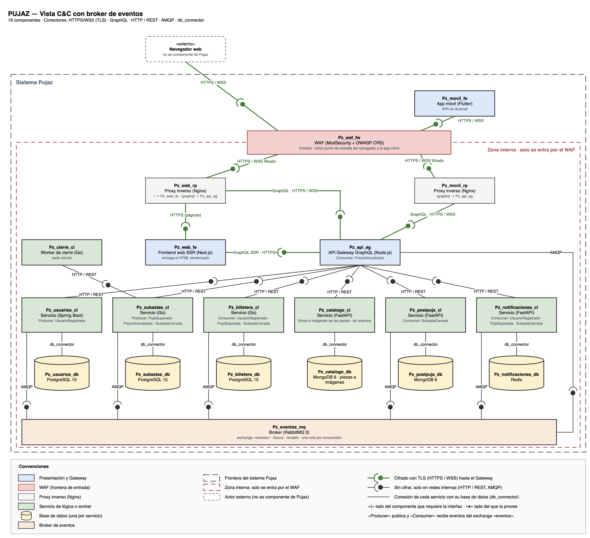

# Vista C&C con broker de eventos · Pujaz

Esta vista muestra los **19 componentes** de Pujaz en tiempo de ejecución y los conectores entre ellos, con el broker de eventos `Pz_eventos_mq` (RabbitMQ) como bus asíncrono en la base del diagrama.

Se considera componente cada pieza de software del sistema que se ejecuta como proceso independiente, sin importar dónde corra. Por eso `Pz_movil_fe`, que corre en Android y no en un contenedor, es un componente igual que los demás.

La línea punteada **Sistema Pujaz** es la frontera del sistema: todo lo que está dentro forma parte de Pujaz. El **navegador web** queda fuera porque no es software de Pujaz: es un actor externo que solo pide páginas y datos. Se dibuja con borde punteado para mostrar por dónde entra el tráfico web.

La línea punteada roja **Zona interna** marca la frontera de confianza. Solo `Pz_movil_fe` queda dentro del sistema pero fuera de esa zona: es software de Pujaz, pero se instala y se ejecuta en el dispositivo del usuario. Nada que venga de fuera toca un componente interno sin pasar antes por el WAF `Pz_waf_fw`.

**Un solo WAF para web y móvil.** El WAF inspecciona cada petición contra un conjunto de reglas (OWASP CRS) y la deja pasar o la bloquea. Ambos canales llegan por HTTP(S) a la misma API (`/graphql` de `Pz_api_ag`), así que comparten la superficie de ataque y las reglas. Un solo WAF concentra en un punto las reglas, la terminación TLS y el registro de ataques. Si un canal necesita ajustes propios, se configuran en el mismo WAF por host o puerto. Dos WAF duplicarían las reglas sin proteger nada adicional.

**Proxies inversos detrás del WAF.** `Pz_web_rp` y `Pz_movil_rp` (Nginx) reciben el tráfico ya filtrado y lo enrutan según la ruta:

- `Pz_web_rp`: `/graphql` va a `Pz_api_ag` y todo lo demás va a `Pz_web_fe`.
- `Pz_movil_rp`: `/graphql` va a `Pz_api_ag`. El resto responde 404.

**Flujo web.** El navegador pasa por `Pz_waf_fw` y llega a `Pz_web_rp`, que lo envía a `Pz_web_fe`. Este consulta a `Pz_api_ag` por la red interna, renderiza la página (SSR) y devuelve el HTML. Después el navegador sigue interactuando por el mismo camino: WAF y proxy, que enruta `/graphql` (incluido el WebSocket del precio en vivo) al Gateway.

**Flujo móvil.** La APK ya está instalada en el dispositivo, así que no pide HTML. Igual pasa por `Pz_waf_fw` y `Pz_movil_rp` por seguridad, y de ahí llega a `Pz_api_ag` (`/graphql`).

*El diagrama editable está en [vista-cc-ball-socket.drawio](vista-cc-ball-socket.drawio).*

Hay una segunda versión del mismo diagrama, con flechas en lugar de la notación `( ●`: [vista-cc-flechas.png](vista-cc-flechas.png) (editable en [vista-cc-flechas.drawio](vista-cc-flechas.drawio)). En ella la flecha sale del componente que inicia la conexión.

## Organización del diagrama

El diagrama se lee de arriba abajo, por capas:

1. **Entrada:** el navegador web (externo, fuera del sistema) y `Pz_movil_fe` (dentro del sistema, fuera de la zona interna).
2. **Frontera:** `Pz_waf_fw`, sobre el borde de la zona interna. Por ahí entra todo el tráfico web y móvil.
3. **Proxies inversos:** `Pz_web_rp` y `Pz_movil_rp`, uno por canal.
4. **Front web y Gateway:** `Pz_web_fe` (SSR) y `Pz_api_ag`. A la izquierda está `Pz_cierre_cl`, que no recibe peticiones; las inicia.
5. **Servicios de lógica:** los seis microservicios. Cada uno indica si es *Producer* o *Consumer* de eventos.
6. **Datos:** la base de datos de cada servicio, justo debajo de él (Database per Service).
7. **Broker:** `Pz_eventos_mq`, como bus al que se conectan todos los productores y consumidores.

El diagrama incluye una leyenda con todas las convenciones. En resumen:

- **Colores de componentes:** azul para presentación y Gateway, rojo para el WAF, gris para los proxies, verde para lógica, amarillo para datos y naranja para el broker.
- **Fronteras:** gris punteada para el sistema Pujaz y roja punteada para la zona interna. El borde punteado redondeado marca un actor externo.
- **Conectores:** notación de interfaz requerida y provista (`──( ●──`). El semicírculo `(` queda del lado del componente que requiere la interfaz e inicia la conexión, y el punto `●` del lado del que la provee. En verde y grueso van los cifrados con TLS; en negro, los que no van cifrados y solo circulan por redes internas. La conexión de cada servicio con su base de datos es una línea simple.

## Componentes

| Componente | Capa | Tecnología | Responsabilidad | Eventos |
|---|---|---|---|---|
| `Pz_web_fe` | Presentación | TypeScript (Next.js) | Aplicación web: listado, detalle, pujas, perfil y billetera. Renderiza las páginas en el servidor (SSR) y entrega el HTML al navegador. | — |
| `Pz_movil_fe` | Presentación | Dart (Flutter), APK en Android | App móvil: login, catálogo, detalle, pujas y precio en vivo. | — |
| `Pz_waf_fw` | Frontera | ModSecurity + OWASP CRS (propuesto) | Punto único de entrada. Inspecciona cada petición HTTP/WS de la web y la app móvil y bloquea ataques (inyección, XSS, peticiones malformadas) antes de que lleguen a los proxies. | — |
| `Pz_web_rp` | Proxy inverso | Nginx | Enruta el canal web: `/graphql` a `Pz_api_ag` y el resto a `Pz_web_fe`. | — |
| `Pz_movil_rp` | Proxy inverso | Nginx | Enruta el canal móvil: `/graphql` a `Pz_api_ag`. | — |
| `Pz_api_ag` | Gateway | Node.js 22 (TypeScript) | API GraphQL única. Valida JWT, orquesta los servicios por HTTP / REST y envía el precio en vivo por WebSocket. | Consumer: `PrecioActualizado` |
| `Pz_cierre_cl` | Lógica (worker) | Go | Cada minuto pide a `Pz_subastas_cl` que cierre las subastas vencidas. No tiene base de datos ni servidor HTTP. | — |
| `Pz_usuarios_cl` | Lógica | Java (Spring Boot) | Registro, inicio de sesión, perfil y roles. | Producer: `UsuarioRegistrado` |
| `Pz_subastas_cl` | Lógica | Go | Publicación de subastas, validación de pujas y cierre. | Producer: `PujaSuperada`, `PrecioActualizado`, `SubastaCerrada` |
| `Pz_billetera_cl` | Lógica | Go | Saldos, reservas, reintegros y cobro al ganador. | Consumer: `UsuarioRegistrado`, `PujaSuperada`, `SubastaCerrada` |
| `Pz_catalogo_cl` | Lógica | Python (FastAPI) | Piezas, fichas, fotos y búsqueda. | — |
| `Pz_postpuja_cl` | Lógica | Python (FastAPI) | Entrega de la pieza ganada y seguimiento. | Consumer: `SubastaCerrada` |
| `Pz_notificaciones_cl` | Lógica | Python (FastAPI) | Avisos por usuario y su consulta por HTTP / REST. | Consumer: `UsuarioRegistrado`, `PujaSuperada`, `SubastaCerrada` |
| `Pz_eventos_mq` | Broker | RabbitMQ 3 | Recibe los eventos en el exchange `eventos` y los copia a la cola de cada consumidor. | — |
| `Pz_usuarios_db` | Datos | PostgreSQL 15 | Usuarios y credenciales. | — |
| `Pz_subastas_db` | Datos | PostgreSQL 15 | Subastas y pujas. | — |
| `Pz_billetera_db` | Datos | PostgreSQL 15 | Billeteras y movimientos. | — |
| `Pz_catalogo_db` | Datos | MongoDB 6 | Piezas e imágenes. | — |
| `Pz_postpuja_db` | Datos | MongoDB 6 | Entregas y su estado. | — |
| `Pz_notificaciones_db` | Datos | Redis | Lista de notificaciones de cada usuario. | — |

*`Pz_spa_fe` existe en el repositorio, pero no forma parte del `docker-compose.yml` actual, por lo que no se incluye.*

## Conectores

**TLS hasta el Gateway.** Todo conector desde el navegador o la APK hasta `Pz_api_ag` va cifrado con TLS (HTTPS / WSS). Eso incluye los saltos internos de esa cadena: WAF → proxies, proxies → `Pz_web_fe` y `Pz_api_ag`, y la consulta SSR de `Pz_web_fe` al Gateway. El WAF descifra para inspeccionar cada petición y vuelve a cifrar hacia los proxies. Desde el Gateway hacia adentro (HTTP / REST, AMQP y db_connector) el tráfico no va cifrado; se protege con la segmentación en redes internas aisladas.

| Conector | Origen | Destino | Descripción |
|---|---|---|---|
| **HTTPS / WSS** | Navegador web (externo) | `Pz_waf_fw` | Peticiones de páginas, queries y mutations, y precio en vivo por WebSocket. Todo entra por el WAF. |
| **HTTPS / WSS** | `Pz_movil_fe` | `Pz_waf_fw` | La app hace queries y mutations, pide imágenes y recibe el precio en vivo por WebSocket a través del mismo WAF. |
| **HTTPS / WSS filtrado** | `Pz_waf_fw` | `Pz_web_rp`, `Pz_movil_rp` | Solo pasa a los proxies el tráfico que cumple las reglas del WAF. |
| **HTTPS (páginas)** | `Pz_web_rp` | `Pz_web_fe` | Peticiones de páginas, que `Pz_web_fe` renderiza con SSR y devuelve como HTML. |
| **GraphQL · HTTPS / WSS** | `Pz_web_rp`, `Pz_movil_rp` | `Pz_api_ag` | Ruta `/graphql` de cada canal hacia el Gateway, incluido el WebSocket del precio en vivo. |
| **GraphQL SSR · HTTPS** | `Pz_web_fe` | `Pz_api_ag` | Consultas para renderizar la página. Nacen de una petición del navegador que ya pasó por el WAF. |
| **HTTP / REST** | `Pz_api_ag` | Los seis servicios de lógica | Orquestación síncrona: el Gateway delega cada operación en el servicio que la resuelve. |
| **HTTP / REST** | `Pz_cierre_cl` | `Pz_subastas_cl` | Petición periódica para cerrar subastas vencidas. Ese cierre es el que publica `SubastaCerrada`. |
| **db_connector** | Cada servicio de lógica | Su propia base de datos | Conexión exclusiva del servicio con su base (Database per Service). |
| **AMQP** | Productores y consumidores | `Pz_eventos_mq` | Publicación y consumo asíncrono de eventos. El broker provee la interfaz (el punto `●` está de su lado) y cada servicio la requiere, porque cada uno abre su propia conexión. |

## Cómo funciona el broker

1. Todos los servicios declaran el mismo exchange `eventos`, de tipo **fanout** y durable.
2. El productor publica cada evento en ese exchange y pone el nombre del evento en la **routing key** (por ejemplo, `SubastaCerrada`).
3. Como el exchange es fanout, RabbitMQ entrega una copia del mensaje a **todas** las colas enlazadas, sin mirar la routing key.
4. Cada consumidor tiene su propia cola. Lee la routing key de cada mensaje y procesa solo los eventos que le interesan.
5. Si un consumidor está caído, los mensajes esperan en su cola durable y se procesan cuando vuelve. La excepción es `Pz_api_ag`, cuya cola es temporal.

| Evento | Publicado por | Consumido por | Efecto |
|---|---|---|---|
| `UsuarioRegistrado` | `Pz_usuarios_cl` | `Pz_billetera_cl`, `Pz_notificaciones_cl` | Crea la billetera y envía la bienvenida. |
| `PujaSuperada` | `Pz_subastas_cl` | `Pz_billetera_cl`, `Pz_notificaciones_cl` | Reintegra la reserva al postor superado y le avisa. |
| `PrecioActualizado` | `Pz_subastas_cl` | `Pz_api_ag` | Envía el precio nuevo por WebSocket a quienes ven la subasta. |
| `SubastaCerrada` | `Pz_subastas_cl` | `Pz_billetera_cl`, `Pz_postpuja_cl`, `Pz_notificaciones_cl` | Cobra al ganador, registra la entrega y avisa a ganador y participantes. |

| Consumidor | Cola | Tipo de cola |
|---|---|---|
| `Pz_api_ag` | Nombre generado por RabbitMQ | Exclusiva y temporal: se borra cuando el Gateway se desconecta. |
| `Pz_billetera_cl` | `billetera_eventos` | Durable |
| `Pz_postpuja_cl` | `postpuja.eventos` | Durable |
| `Pz_notificaciones_cl` | `pujaz.notificaciones` | Durable |
