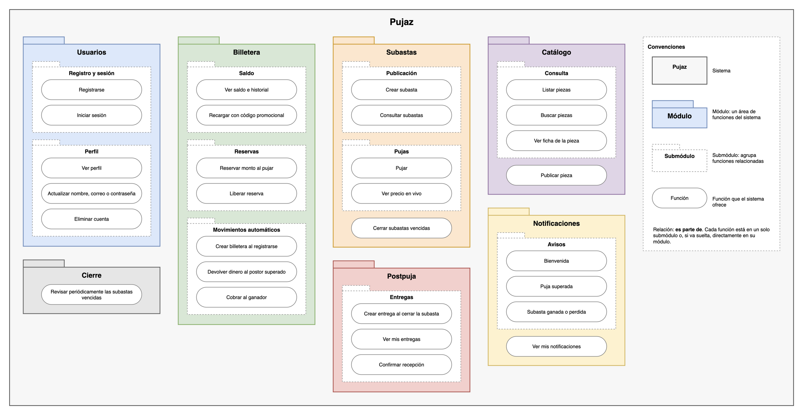

# Vista de descomposición funcional - Pujaz

## Descripción

Esta vista muestra la **estructura de descomposición** de Pujaz desde sus funciones: el sistema se divide en módulos, cada módulo en submódulos y cada submódulo en las funciones que ofrece. No muestra cómo se comunican los módulos (eso está en la [vista C&C](../cc/vista-cc-broker.md)) ni en qué nivel corre cada uno (eso está en la [vista de capas](../capas/vista-capas.md)).

La vista por componente técnico (controladores, repositorios, clientes…) sigue en [vista-descomposicion.png](vista-descomposicion.png).

**Elementos**

| Elemento | Qué es en Pujaz |
|---|---|
| **Sistema** | Pujaz, la casa de subastas. |
| **Módulo** | Un área de funciones del sistema. Hay 7. |
| **Submódulo** | Un grupo de funciones relacionadas dentro de un módulo. |
| **Función** | Algo que el sistema hace o le ofrece al usuario. |

**Relación:** *es parte de*. Cada función está en un solo submódulo o, si va suelta, directamente en su módulo. Cada submódulo está en un solo módulo.

## Diagrama

El fuente editable está en [vista-descomposicion-funcional.drawio](vista-descomposicion-funcional.drawio).

**Convenciones** (también en el cuadro *Convenciones* del diagrama)

| Elemento | Forma |
|---|---|
| Sistema | Caja gris con el nombre "Pujaz" arriba |
| Módulo | Carpeta de color, con el nombre en negrita. Cada módulo tiene un color distinto solo para diferenciarlo. |
| Submódulo | Carpeta blanca con borde punteado, dentro de un módulo |
| Función | Óvalo blanco, dentro de un submódulo o suelto en el módulo |

## Módulos

| Módulo | Responsabilidad | Componente que lo implementa |
|---|---|---|
| Usuarios | Cuentas, inicio de sesión y perfil. | Pz_usuarios_cl |
| Billetera | Saldo, recargas, reservas de las pujas y cobros. | Pz_billetera_cl |
| Subastas | Publicar subastas, recibir pujas y cerrarlas. | Pz_subastas_cl |
| Cierre | Revisar cada cierto tiempo si hay subastas vencidas. | Pz_cierre_cl |
| Catálogo | Las piezas: listado, búsqueda, ficha y publicación. | Pz_catalogo_cl |
| Postpuja | La entrega de la pieza ganada. | Pz_postpuja_cl |
| Notificaciones | Los avisos de cada usuario. | Pz_notificaciones_cl |

Pz_web_fe, Pz_movil_fe, Pz_api_ag y los componentes del perímetro no aparecen como módulos: exponen o coordinan estas funciones, pero no tienen funciones de negocio propias.

## Funciones por módulo

### 1. Usuarios
- **Registro y sesión:** registrarse (rol por defecto: comprador); iniciar sesión (las cuentas inactivas no pueden entrar).
- **Perfil:** ver el perfil; actualizar nombre, correo o contraseña; eliminar la cuenta.

### 2. Billetera
- **Saldo:** ver el saldo disponible y reservado con el historial de movimientos; recargar con código promocional.
- **Reservas:** reservar el monto al pujar; liberar la reserva si la puja falla.
- **Movimientos automáticos** (llegan por eventos): crear la billetera en 0 al registrarse un usuario; devolver el dinero al postor superado; cobrar al ganador al cerrar la subasta.

### 3. Subastas
- **Publicación:** crear la subasta de una pieza; consultar subastas por id, por pieza o varias a la vez.
- **Pujas:** pujar (al menos 100 sobre el precio actual); ver el precio en vivo sin recargar la página.
- **Suelta:** cerrar las subastas vencidas.

### 4. Cierre
- **Suelta:** revisar periódicamente y pedir que se cierren las subastas vencidas.

### 5. Catálogo
- **Consulta:** listar piezas; buscar por nombre o descripción; ver la ficha de una pieza (imágenes, documentos y precio base).
- **Suelta:** publicar una pieza nueva.

### 6. Postpuja
- **Entregas:** crear la entrega al cerrar la subasta; ver mis entregas; confirmar que recibí la pieza (solo el ganador).

### 7. Notificaciones
- **Avisos:** bienvenida al registrarse; puja superada; subasta ganada o perdida.
- **Suelta:** ver mis notificaciones.
